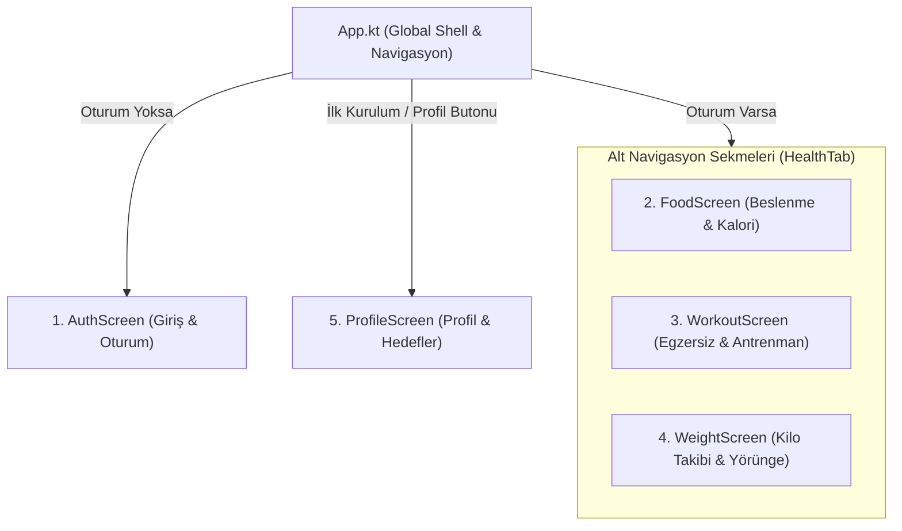
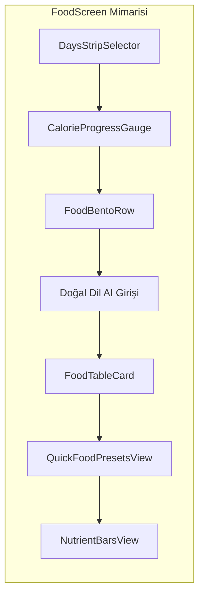

# HealthTrack — Ekranlar ve İşlevler Kılavuzu

Bu döküman, **HealthTrack** (Kotlin Multiplatform / Compose Multiplatform) uygulamasında yer alan tüm ekranları, bu ekranların mimari bileşenlerini, kullanıcı etkileşimlerini, MVI (Model-View-Intent) akışlarını ve arka plandaki veri modellerini adım adım açıklamaktadır.

---



---

## 1. Giriş ve Kimlik Doğrulama Ekranı (`AuthScreen`)

* **Dosya Yolları:** 
  * UI: `feature/auth/presentation/AuthScreen.kt`
  * MVI State & Intent: `feature/auth/presentation/AuthMvi.kt`
  * ViewModel: `feature/auth/presentation/AuthViewModel.kt`
  * Önizleme: `feature/auth/presentation/AuthPreviews.kt`

### 1.1 Amacı
Kullanıcının sisteme e-posta/kullanıcı adı ve şifre ile giriş yapmasını, oturum açma durumunu (JWT token saklama) ve hata bildirimlerini yönetir.

### 1.2 Bileşenler ve İşlevler
1. **Kimlik Girdi Alanı (`identifier`):**
   * Kullanıcı adı veya e-posta adresi yazılır.
   * `clearFocusOnTap()` ile boşluğa dokunulduğunda klavye otomatik gizlenir.
2. **Şifre Girdi Alanı (`password`):**
   * Şifre maskeleme (`PasswordVisualTransformation`) ve sağdaki göz ikonuyla görünürlük geçişi (`Visibility` / `VisibilityOff`).
3. **Giriş Butonu (`OnLoginClicked`):**
   * Kimlik doğrulama isteğini ViewModel üzerinden `AuthRepository`'ye gönderir.
   * Yüklenme durumunda buton içinde döner indikatör (`CircularProgressIndicator`) gösterir.
4. **Hata Banner'ı (`errorMessage`):**
   * Yanlış şifre, eksik bilgi veya sunucu erişilememe durumlarında kullanıcıya aksiyonel bildirim sunar.
5. **Oturum Geçişi:**
   * Başarılı girişte `AuthEffect.NavigateToHome` tetiklenir ve `sessionFlow` güncellenerek ana kabuk (`App.kt`) açılır.

---

## 2. Beslenme ve Günlük Kalori Ekranı (`FoodScreen`)

* **Dosya Yolları:**
  * UI: `feature/food/presentation/FoodScreen.kt`
  * MVI State & Intent: `feature/food/presentation/FoodMvi.kt`
  * ViewModel: `feature/food/presentation/FoodViewModel.kt`
  * Önizleme: `feature/food/presentation/FoodPreviews.kt`



### 2.1 Amacı
Günlük alınan kaloriyi, makro besinleri (Protein, Karbonhidrat, Yağ) ve mikro besinleri (Lif, Magnezyum, Demir vb.) takip eder; yapay zeka ile doğal dilde yazılan öğünleri otomatik analiz eder.

### 2.2 Adım Adım Alt Bileşenler ve Özellikleri

#### A. 7 Günlük Kompakt Şerit Seçici (`DaysStripSelector`)
* **Konum:** Ekranın en üstünde, fold üstü kompakt zaman çizelgesi.
* **İşlev:** Geçmiş ve bugünkü günler arasında hızlı geçiş sağlar. Haftalık geçiş butonları (`ChevronLeft` / `ChevronRight`) ile geçmiş haftaların beslenme geçmişine gidilebilir.

#### B. Konsantrik Kalori ve Makro Halkası (`CalorieProgressGauge`)
* **Ana Halka:** Günlük hedef kaloriye göre tüketilen kaloriyi ve harcanan kaloriyi dairesel animasyonlu halkada gösterir.
* **Kalan Kalori Telemetrisi:** Ortada kalan kalori miktarı ve durum bildirimi yer alır.
* **Dinamik Makro Kapsülleri:** Doğrudan halkanın altında:
  * **Protein:** `0 / 140g` (Kullanıcının güncel kilosu ve fitness hedefine göre dinamik hesaplanır).
  * **Karbonhidrat:** `0 / 220g`.
  * **Yağ:** `0 / 65g`.

#### C. İkili Bento Kart Satırı (`FoodBentoRow`)
* **Sol Kart (Mikro Besin Özeti):** Lif, Demir ve Magnezyum değerlerinin dairesel kapsül durumları. Tıklandığında `GeneralMicronutrientsBottomSheet` açılarak tüm vitamin ve minerallerin detayını listeler.
* **Sağ Kart (Kilo & Dalga Grafiği):** Seçili günün veya en son tartı kaydının kilosu, fark telemetrisi (+/- kg) ve neon ışıltılı mini sparkline dalga çizgisi. Tıklandığında doğrudan Kilo sekmesine yönlendirir.

#### D. Yapay Zeka Destekli Doğal Dil Girişi (`FoodAiReviewBottomSheet`)
* Kullanıcı `"200g ızgara tavuk, 1 kase yoğurt ve 1 adet elma yedim"` gibi serbest metin yazar.
* AI Analiz butonu metni sunucuya iletir; porsiyonlar, gramajlar, kalori ve tüm makro/mikro kırılımlar otomatik ayrıştırılır.
* Onay sayfası açılarak kullanıcıya son düzeltme imkanı tanınır ve tek tıkla kaydedilir.

#### E. Günlük Besin Manifestosu Tablosu (`FoodTableCard`)
* O gün eklenmiş olan tüm besinleri liste kartı olarak gösterir:
  * Besin adı, porsiyon bilgisi, kalori değeri, makro rozetleri.
  * Tekil besin silme (`OnRemoveItem`) ve tüm günü sıfırlama (`OnClearFoodLog`).

#### F. Hızlı Besin Çipleri & Özel Ürünler (`QuickFoodPresetsView`)
* Kategorilere göre filtrelenebilir (Tümü, Favoriler, Özel Ürünlerim, Protein, Kahvaltı, Karbonhidrat vb.).
* Hazır porsiyon çarpanları (`1x`, `2x`, `3x`) ile tek tıkla anında öğün ekleme.
* `AddCustomFoodDialog` ile barkodsuz/özel gıdaları kişisel veritabanına ekleme.

#### G. Ayrıntılı Telemetri Besin Barları (`NutrientBarsView`)
* Tüm makro ve mikro elementlerin hedef yüzdelerini gösteren biyolüminesans dikey kapsül barları.

---

## 3. Egzersiz ve Aktivite Ekranı (`WorkoutScreen`)

* **Dosya Yolları:**
  * UI: `feature/workout/presentation/WorkoutScreen.kt`
  * MVI State & Intent: `feature/workout/presentation/WorkoutMvi.kt`
  * ViewModel: `feature/workout/presentation/WorkoutViewModel.kt`
  * Önizleme: `feature/workout/presentation/WorkoutPreviews.kt`

### 3.1 Amacı
Fiziksel aktiviteleri, kardiyo ve direnç antrenmanlarını kaydeder; kalori harcamasını hesaplayarak günün net enerji dengesini oluşturur.

### 3.2 Bileşenler ve İşlevler
1. **Tarih Şeridi (`DaysStripSelector`):** Antrenmanın yapıldığı günü seçme.
2. **Egzersiz Telemetri Göstergesi:**
   * Yakılan Kalori vs Hedef Kalori (örn. 560 / 500 kcal).
   * Egzersiz Süresi vs Hedef Süre (örn. 75 / 60 dk).
3. **Net Kalori Dengesi:**
   * `Net Kalori = Alınan Kalori - Yakılan Kalori` formülü ile kullanıcının kalori açığında (deficit) mı yoksa fazlasında (surplus) mı olduğunu anlık telemetri kartında gösterir.
4. **AI Destekli Antrenman Girişi:**
   * `"45 dakika tempolu koştum (6.2 km) ve 30 dk üst vücut ağırlık çalıştım"` gibi serbest metin girişi.
   * AI, kullanıcının vücut ağırlığını dikkate alarak MET (Metabolic Equivalent of Task) değerine göre yakılan kaloriyi hesaplar.
5. **Manuel Egzersiz Girişi:**
   * Egzersiz adı, tahmini kalori ve süre (dakika) girilerek hızlı ekleme.
6. **Antrenman Günlüğü Listesi:**
   * Eklenen tüm aktiviteleri süre, kalori ve AI biyomekanik analiz özeti ile listeler; tek tıkla silme desteği sağlar.

---

## 4. Kilo Takibi ve Yörünge Ekranı (`WeightScreen`)

* **Dosya Yolları:**
  * UI: `feature/weight/presentation/WeightScreen.kt`
  * MVI State & Intent: `feature/weight/presentation/WeightMvi.kt`
  * ViewModel: `feature/weight/presentation/WeightViewModel.kt`
  * Önizleme: `feature/weight/presentation/WeightPreviews.kt`

### 4.1 Amacı
Vücut ağırlığının zaman içerisindeki seyrini takip eder, hedef kiloya olan uzaklığı görselleştirir ve istatistiksel trend analizi sunar.

### 4.2 Bileşenler ve İşlevler
1. **İnteraktif Yörünge Çizgi Grafiği (`WeightLineChart`):**
   * Biyolüminesans neon çizgi ve degrade dolgulu alan grafiği.
   * Noktalara dokunulduğunda ilgili günün net kilosunu ve bir önceki tartıya göre olan delta değişimini (`+0.4 kg` veya `-0.3 kg`) gösteren dinamik bilgi kartı.
   * Kesikli hedef çizgisi (`Target Weight`).
2. **Periyot Filtresi (`WeightChartPeriod`):**
   * **Haftalık (WEEKLY):** Son 7 günün mikro dalgalanmaları.
   * **Aylık (MONTHLY):** 30 günlük seyir.
   * **Yıllık (YEARLY):** 12 aylık periyot.
   * **Tümü (ALL):** Kayıt başlangıcından bu yana olan tüm seyir.
3. **Kilo Metrik Özet Kartları:**
   * **Güncel Kilo:** En son kaydedilen tartı değeri.
   * **Başlangıç Kilosu:** Sisteme girilen ilk kayıt.
   * **Toplam Değişim:** Başlangıçtan bugüne verilen veya alınan net kilo.
   * **Hedefe Kalan:** Hedef kiloya ulaşmak için gereken miktar.
4. **Hedef Kilo Düzenleme (`EditTargetWeightDialog`):**
   * Hedeflenen kilo değerini modal pencere üzerinden anında güncelleme.
5. **Hızlı Kilo ve Not Girişi:**
   * Tarih seçici, kilo metin kutusu ve durum notu (örn. *"Sabah aç karnına, kardiyo sonrası"*).
6. **Kilo Kayıt Geçmişi:**
   * Kronolojik sıralı liste, yeşil/kırmızı trend okları ve kayıt silme aksiyonu.

---

## 5. Profil, Hedefler ve Ayarlar Ekranı (`ProfileScreen`)

* **Dosya Yolları:**
  * UI: `feature/profile/presentation/ProfileScreen.kt`
  * MVI State & Intent: `feature/profile/presentation/ProfileMvi.kt`
  * ViewModel: `feature/profile/presentation/ProfileViewModel.kt`
  * Önizleme: `feature/profile/presentation/ProfilePreviews.kt`

### 5.1 Amacı
Kullanıcının kişisel biyometrisini, fitness vizyonunu, beslenme hedeflerini, tema tercihlerini ve oturum güvenliğini yönetir.

### 5.2 Bileşenler ve İşlevler
1. **Biyometrik Profil:**
   * Ad, Kullanıcı Adı, Cinsiyet (Erkek / Kadın), Yaş, Boy (cm), Güncel Kilo ve Hedef Kilo.
2. **Otomatik Vücut Kitle İndeksi (BMI) Hesabı:**
   * $\text{BMI} = \frac{\text{Kilo (kg)}}{(\text{Boy (m)})^2}$ formülü ile anlık hesaplanır.
   * Dinamik Renkli Kategori Etiketi: *Zayıf*, *İdeal / Sağlıklı*, *Fazla Kilolu*, *Obezite*.
3. **Fitness Hedefi Seçimi (`FitnessGoal`):**
   * **Kilo Verme (`LOSE_WEIGHT`):** Yağ yakımı & kas koruma odağı ($1.2\times$ vücut ağırlığı protein).
   * **Sabit Kalma (`MAINTAIN`):** Form ve denge koruma ($1.0\times$ vücut ağırlığı protein).
   * **Kaslanma (`BUILD_MUSCLE`):** Hipertrofi ve kas inşası ($1.4\times$ vücut ağırlığı protein).
   * **Dinamik Protein Tavsiyesi:** Seçilen hedefe ve vücut ağırlığına göre günlük hedef protein miktarı gram cinsinden anında yeniden hesaplanır.
4. **Görünüm & Tasarım Sistemi Ayarları:**
   * **Koyu Mod Geçişi (`isDarkMode`):** Obsidian Dark ve Pristine Light temaları arasında anlık geçiş.
   * **Tema Vurgu Rengi (`themeAccent`):** `TEAL` (Siyanür/Turkuaz) veya `EMERALD` (Zümrüt Yeşili) renk paletleri arasında dinamik geçiş.
5. **Senkronizasyon (Sync) İşlemi:**
   * Yerel Room veritabanındaki bekleyen (`PENDING`) kayıtları uzak API ile eşitleyen manuel tetikleyici.
6. **Güvenli Çıkış (`OnLogoutClicked`):**
   * Kullanıcı oturumunu ve yerel anahtarları sonlandırarak `AuthScreen` ekranına dönüş sağlar.

---

## 6. Global Navigasyon Kabuğu ve Ekosistem Geçişi (`App.kt`)

* **Dosya Yolu:** `app/shared/src/commonMain/kotlin/com/yusufteker/healthtrack/App.kt`

### 6.1 Üst Çubuk (TopAppBar)
* **Brand Pod (`"H"`):**
  * HealthTrack'in neon degrade ikon pod'u.
  * Üzerine tıklandığında kardeş uygulama olan **Planora ("P")** geçiş rozetini animasyonla açar (`isEcoSwitcherOpen`). Cihazda Planora yüklüyse tek dokunuşla Planora'ya geçiş yapılır.
* **Kullanıcı Başlığı:** Aktif kullanıcının adı veya `@kullaniciadi`.
* **Profil Butonu:** `ProfileScreen` ekranını tam ekran olarak açar.

### 6.2 Alt Navigasyon Çubuğu (Bottom Navigation Bar)
* 3 Temel Sekme:
  1. 🥗 **Yemek (`HealthTab.FOOD`)** $\rightarrow$ `FoodScreenRoot`
  2. 🏋️ **Spor (`HealthTab.WORKOUT`)** $\rightarrow$ `WorkoutScreenRoot`
  3. ⚖️ **Kilo (`HealthTab.WEIGHT`)** $\rightarrow$ `WeightScreenRoot`
* **Klavye Akıllı Gizleme Kuralı:** Kullanıcı herhangi bir girdi alanına tıkladığında alt navigasyon çubuğu yumuşak bir dikey animasyonla gizlenir (`isImeVisible` / `WindowInsets.ime`). Böylece ekran alanı maksimum verimlilikle kullanılır.

---

## 7. MVI ve Durum Yönetimi Şeması

Tüm ekranlar HealthTrack genelinde aynı MVI disipliniyle çalışır:

```
┌────────────────────────────────────────┐
│             UI / Composable            │
│   (ScreenRoot & Stateless Screen)      │
└───────────────▲────────────────┬───────┘
                │ State          │ Intent
                │ Flow           │ Action
┌───────────────┴────────────────▼───────┐
│               ViewModel                │
│    (StateFlow<State>, onIntent())      │
└───────────────▲────────────────┬───────┘
                │ Result         │ Execute
                │ Flow           │ Command
┌───────────────┴────────────────▼───────┐
│              Repository                │
│       (Room Database & Ktor API)       │
└────────────────────────────────────────┘
```

1. **`ScreenRoot`:** Koin üzerinden ViewModel'ı enjekte eder, State'i `collectAsStateWithLifecycle()` ile dinler ve Intent'leri ViewModel'a iletir.
2. **`Screen`:** Tamamen saf (stateless) composable'dır. ViewModel bilmez; `state` alır ve `onIntent` lambda'sı fırlatır. Bu sayede tüm ekranlar `%100` izole şekilde `@Preview` fonksiyonları ile önizlenebilir.

